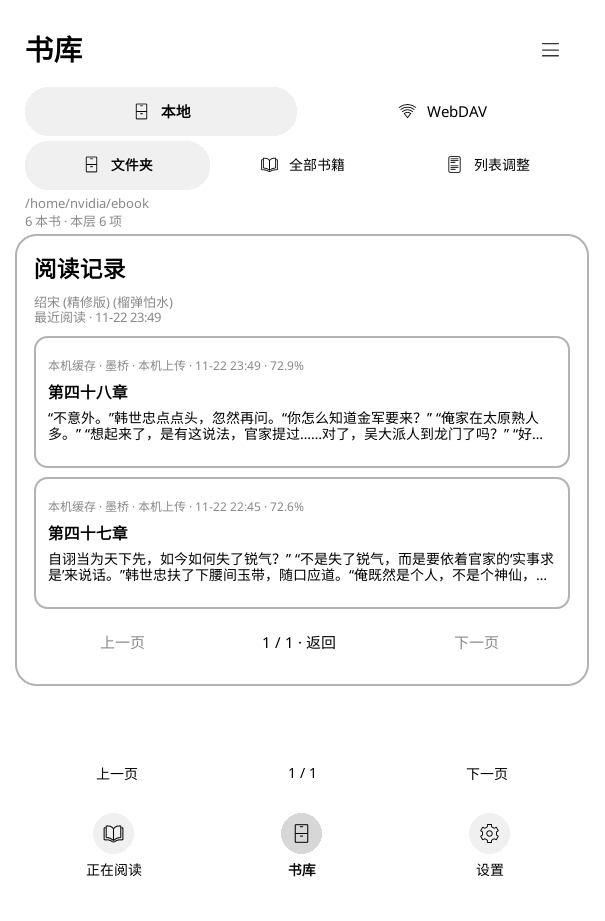

# InkBridge+ / 墨桥+

面向 KOReader 的书籍调校与跨平台阅读进度同步插件。

InkBridge+（墨桥+）继承 InkBridge 的同步能力，以「墨」整理书籍和阅读界面，以「桥」连接不同设备的阅读位置。

[下载最新版](https://github.com/9990ex/inkbridge.koplugin/releases/latest) · [0.3.30 图文指南](docs/v0.3.30-guide.md) · [完整使用说明](inkbridge.koplugin/README.md)

新增的阅读记录页将本机阅读历史与同步记录管理放到一起；EPUB 元数据编辑器同时提供文件名编辑入口。更多实际界面和操作步骤见 [图文指南](docs/v0.3.30-guide.md)。

## 第一阶段目标

- 在不同平台的 KOReader 设备之间同步当前阅读位置；
- 以 WebDAV 作为首要云端传输方式；
- 使用图书内容哈希识别同一本书，减少路径差异带来的问题；
- 尽量保留 KOReader 的精确位置（xpointer），并提供百分比回退；
- 支持手动同步与跳转确认；
- 冲突时保护本地阅读进度，不静默覆盖用户数据。

## 后续方向

- Moon+ Reader（静读天下）阅读进度互通；
- Legado 等其他 Android 阅读器适配（只差一份真机进度文件样本）；
- 不同阅读器位置格式之间的转换；
- 更适合手机和平板的 KOReader 工作流。

> **Readest 明确不做**：它的 WebDAV 通道只认 EPUB CFI、不解析 KOReader 的 xpointer，
> 接上去位置不会动还可能把对方拖回前面；它自带免费的 KOReader 同步通道。
> 破译结论与逐条证据见 [`research/readest-webdav-format.md`](research/readest-webdav-format.md)。

## 暂不计划

- 书籍文件同步；
- 批注、笔记和高亮同步；
- 阅读统计与社交功能；
- 不必要的后台服务和复杂功能。

## 当前状态

**当前版本为 0.3.33-alpha**。阅读中的进度选择改为无图标纵向文字卡片，直接展示章节、时间、设备与两行原文选段，关闭或切书后停止补全。保留在线更新闪退修复；0.3.31 及更早版本需退出 KOReader 后手动覆盖插件目录升级。手动下载不同设备的墨桥记录时，先并排展示本机与远端位置、章节和两行正文摘要，并显示正文比较与跳转预估；用户可选择跳转、上传本机或取消。预览弹窗针对 420×720 窄屏优化，取消不会改变本机位置。顶栏前两项为平级的「桥、墨」：双向箭头表示跨设备同步，调节滑杆表示书籍调校。书籍详情统一提供「阅读记录」，本地／WebDAV、文件夹浏览、离线农历和真实章节选段均保留。
0.3.0 是正式版基线；之后的小改动继续走 **`0.3.x-alpha`**（0.3.1-alpha、0.3.2-alpha…），
不跳大版本号。
上传、下载与跨设备跳转已在 Android 与 Kindle 设备上实测；具体覆盖范围和精度限制见插件说明。

这是 0.x 版本：核心功能已真机验证，但仍在打磨，不代表稳定版本。使用前请先读插件自己的说明
[`inkbridge.koplugin/README.md`](inkbridge.koplugin/README.md)。

### 安装

1. 到 [Releases](../../releases) 下载最新的 `inkbridge.moon.koplugin-v*-alpha.zip`；
2. 解压得到 `inkbridge.koplugin/` 目录（**不要**只解压里面的文件）；
3. 放进 KOReader 的 `plugins/` 目录：
   - Kobo：`.adds/koreader/plugins/`
   - Kindle：`koreader/plugins/`
   - Android：`/sdcard/koreader/plugins/`
4. 完整重启 KOReader，顶栏 **桥** 用于跨设备同步，旁边的 **墨** 用于书籍工具与首页。

首次使用从 **桥 → 高级选项 → 存储选项 → 墨桥同步目录** 配置云同步
（只配了一台服务器时会直接进目录浏览），并在里面**长按**「Long-press here to choose current folder」
那一项来选定云端目录（KOReader 的标准交互）。

> 包内目录名**永远**是 `inkbridge.koplugin/`，只有压缩包的**文件名**带 `.moon.`
> —— KOReader 靠目录名认插件，改名会让老用户升级时多出一个旧插件。

### 参与开发

见 [`DEVELOPMENT.md`](DEVELOPMENT.md)：如何跑回归测试（断言数见 `AGENTS.md`，不需要设备）、
进度记录的定位原理，以及已知问题清单。

## 设计原则

- 小而专注；
- 数据由用户自己掌控；
- WebDAV 优先；
- 失败不覆盖本地进度；
- 兼容性和可恢复性优先；
- 不把实验性功能包装成稳定功能。

## 说明

InkBridge 是独立项目，与 Syncery 没有官方隶属关系。早期设计会参考现有开源项目的经验，
但不会把未完成的实验代码当作本项目的正式实现。

## 开发方式

**Powered by DeepSeek** —— 本项目的代码、回归测试与文档均在 DeepSeek 的辅助下完成。
当前版本通过 18 组、1953 条回归断言（不需要设备即可运行，见 [`DEVELOPMENT.md`](DEVELOPMENT.md)），
关键链路由真机验证。

> DeepSeek 在这里是开发工具。本项目与 DeepSeek 官方没有任何隶属关系。

## 名称

**InkBridge+ / 墨桥+**：连接不同阅读设备，也连接不同阅读软件之间的阅读进度。

## 许可证

本项目以 [GNU General Public License v3.0](LICENSE) 授权。

> 说明：InkBridge+ 是 KOReader 的插件，运行时会 `require` KOReader 自身的模块；
> KOReader 本体以 AGPL-3.0 发布。
