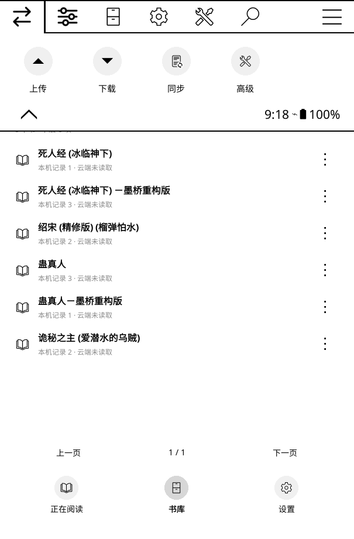
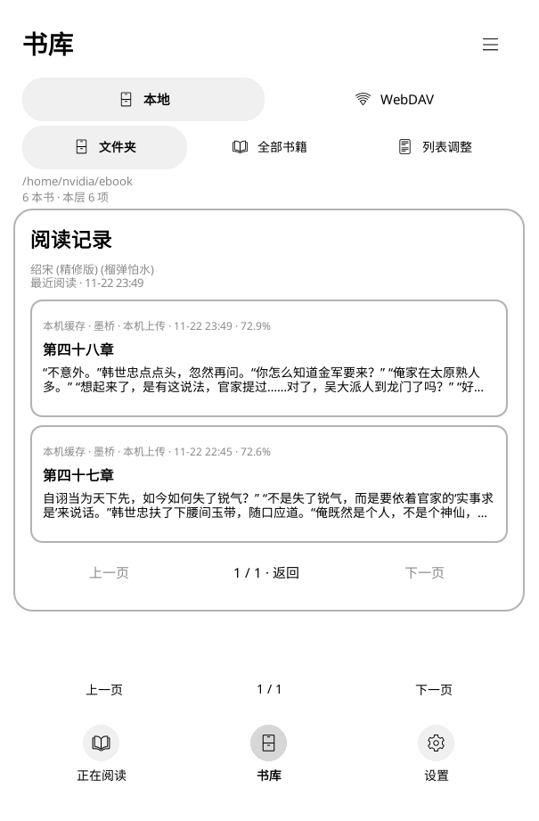
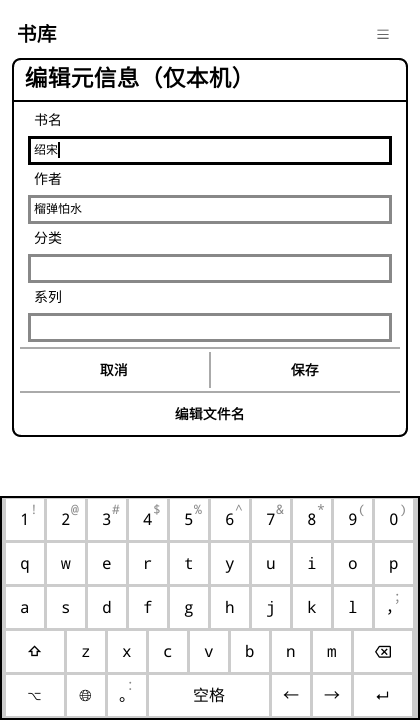
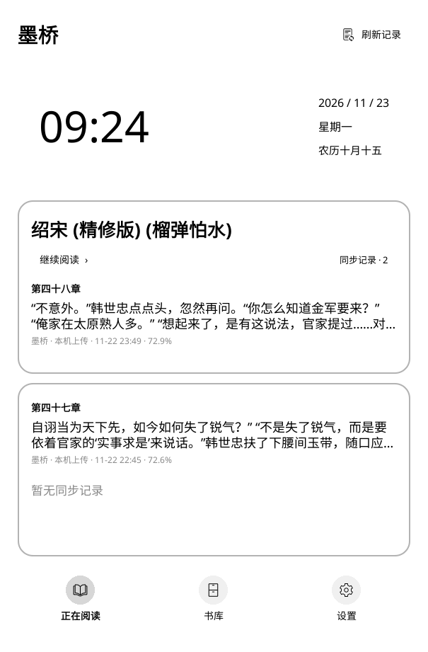

# v0.3.30-alpha — 书籍调校 · 阅读记录卡片 · 元信息编辑

本次汇总自 `0.3.19-alpha` 以来的新功能。墨桥分为两部分：**墨负责书籍调校，桥负责跨设备同步**，并为墨水屏更新了首页、书库和记录管理界面。

[完整图文指南](https://github.com/9990ex/inkbridge.koplugin/blob/v0.3.30-alpha/docs/v0.3.30-guide.md) · [使用说明与静读天下配置](https://github.com/9990ex/inkbridge.koplugin/blob/v0.3.30-alpha/inkbridge.koplugin/README.md)

## 两个模块，两个线性图标

- **双向箭头：桥**，提供上传、下载、同步状态和高级设置。
- **调节滑杆：墨**，提供书籍重构、章节跳转、内容搜索、快速跳转和首页。
- 圆形图标留出独立间距，操作按钮和底部导航统一高度与对齐，去除插件按钮的黑色按压反色。

## 阅读记录直接展示章节和摘要

书籍详情中的「阅读历史」与「管理同步记录」合并为 **阅读记录**。同页可查看最近本机阅读时间，以及本机缓存和已读取的云端记录；卡片直接展示来源、时间、章节、进度和正文摘要，记录较多时分页。

点击卡片查看完整摘录，可前往该位置、确认删除此条或返回。打开列表前关闭书籍菜单，修复记录被菜单遮挡的问题。删除仍区分本机与云端，取消或核验失败时保留记录；缺失章节的旧记录明确显示「章节未记录」。

## EPUB 元信息与文件名集中编辑

「EPUB 元数据」打开书名、作者、分类、系列四字段表单，下方增加 **编辑文件名**，书籍详情不再重复放改名入口。改名保留扩展名，拒绝覆盖同名文件或目标阅读数据，并迁移相关阅读索引；成功后保留尚未保存的元信息输入。

**元信息只保存到 KOReader 本机阅读数据，不写回 EPUB，也不自动跨设备同步。文件名改动确认后立即生效，元信息仍需另点保存。**

## 首页、书库、重构与更新

- **正在阅读**展示最近打开的一本书及三条阅读记录位置，包含时钟、公历、离线农历、真实章节与原书选段。
- **书库**默认浏览本地目录，可切换 WebDAV，支持文件夹层级、全部书籍、列表密度和排序；点书籍行阅读，点「⋮」管理。
- **书籍重构**可重新识别章节或按原正文文件分章，另存纯文字 EPUB 副本，提供进度和取消。副本按新书处理，不覆盖原书、不迁移原书位置与批注。
- **插件内更新**支持确认下载、包与版本校验，以及替换失败恢复；修复检查更新误报连接失败。
- **文件安全管理**支持保留标记和两种删除方式，操作前重新核对文件身份，删除仍需最终确认。

## 安装与升级

下载附件 `inkbridge.moon.koplugin-v0.3.30-alpha.zip`，退出 KOReader，将其中整个 **`inkbridge.koplugin/`** 目录放入或覆盖到 `plugins/`，保持目录名不变，再完整重启。

顶栏双向箭头进入桥，调节滑杆进入墨；首页入口为 **墨 → 首页**。首次同步配置为 **桥 → 高级 → 存储选项 → 墨桥同步目录**，云浏览器选择当前目录需长按。书目目录与同步记录目录分别配置。

## 验证与范围

- **18 组、1930 条 LuaJIT 回归全部通过**；安装包逐文件与发布源码校验一致。
- 本机 KOReader 常规和窄窗口界面检查通过；临时 EPUB 的真实 DocSettings 保存、回读与原文件内容不变检查通过。
- 配图为此前保存的实际开发窗口截图；这些验证不代表所有设备型号和 KOReader 分支均已覆盖。
- 分页模式仍按页定位；不同排版下，记录首行可能位于目标页中间。静读天下互通仍需相同原书内容和正确的坐标配置。

附件同时提供 SHA-256 校验文件与逐文件清单。
