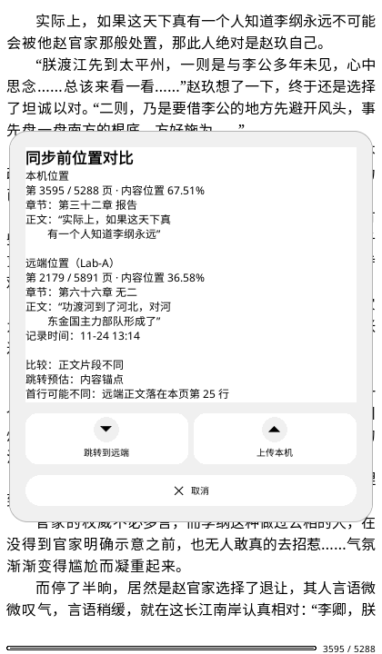

# v0.3.31-alpha — 同步前差异预览

本版把手动下载远端阅读记录改为可比较、可选择的同步流程。选中不同设备的墨桥记录后，先看到本机与远端的位置，再决定采用哪一边。

## 同步前位置对比

预览显示：

- 本机与远端页码、总页数和内容位置；
- 本机与远端章节；
- 两行真实正文摘要；
- 远端设备和记录时间；
- 正文片段是否一致；
- 预计使用的定位方式，以及分页模式下可能出现的首行差异。

预览提供三个动作：

- **跳转到远端**：采用远端记录，继续使用原有的 xpointer、正文搜索或页码回退逻辑；
- **上传本机**：保留本机当前位置并将它作为新的墨桥记录上传；
- **取消**：关闭预览，不改变本机位置，也不写云端。

正文摘要固定为两行，预览卡片使用更大的正文文字、浅色底、圆角留白和独立的上下行图标按钮，适配 420×720 窄屏。

## 安全与兼容

- 下载仍使用只读 WebDAV provider，不会因为查看远端记录而重新上传；
- 预览中的章节只从已核验的本机目标位置读取，不写入云端载荷；
- 取消、下载和跳转不会改变云端历史文件；
- 保留原有书籍身份、xpointer 有效性预检和分页模式页级定位语义；
- Moon+、TXT、静读天下和已有历史记录格式不变。

## 验证

- 完整 LuaJIT 回归：**18 组、1953 条通过，0 失败**；
- WSL 中两个真实 KOReader 2026.07.1 实例双向同步验证通过；
- 使用 605×921 与 420×720 两个隔离窗口，同一本 EPUB 的排版页数不同；
- A → B、B → A 均命中相同 xpointer 与正文锚点；
- 取消预览不改变阅读位置或云端文件；
- 选择上传本机不先跳转；
- 窄屏预览的两行正文、比较结果和定位提示完整可见；
- 原书内容 SHA-256 未变化，源码 `git diff --check` 通过。

详细过程、审计数据和截图见 [双实例验证报告](https://github.com/9990ex/inkbridge.koplugin/blob/v0.3.31-alpha/research/sync-preview-validation-2026-11-23.md)。

## 安装

下载附件 `inkbridge.moon.koplugin-v0.3.31-alpha.zip`，退出 KOReader，将其中整个 **`inkbridge.koplugin/`** 目录放入或覆盖到 `plugins/`，保持目录名不变，再完整重启 KOReader。
