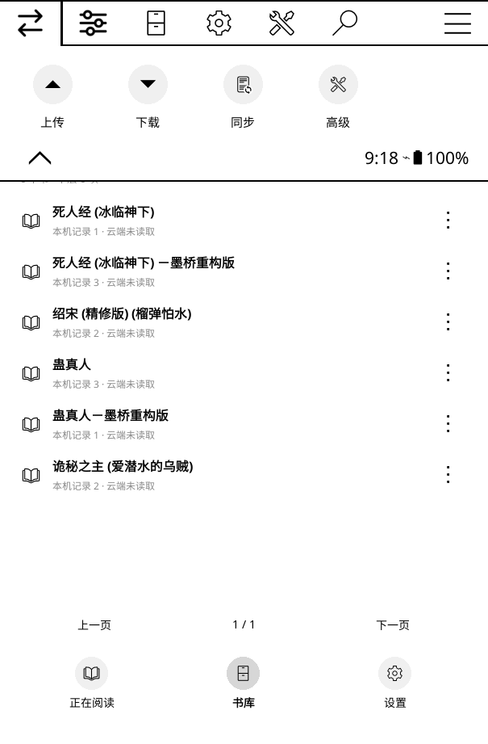
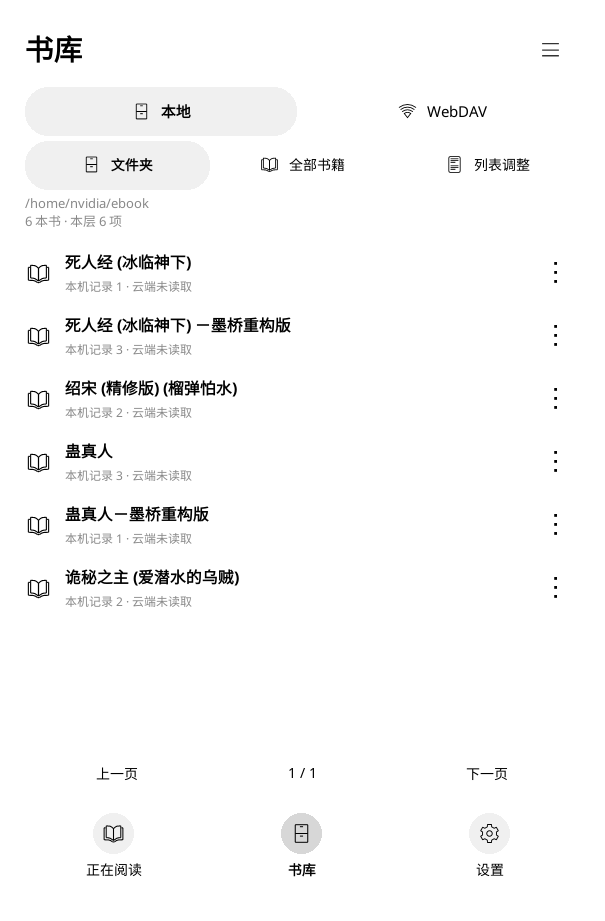
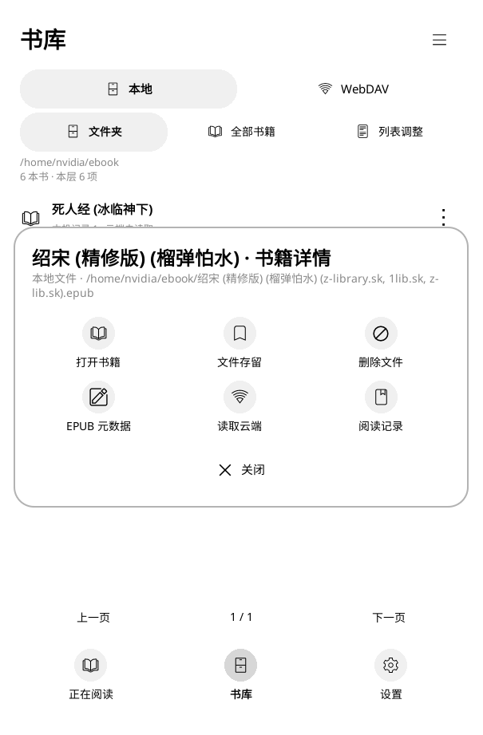
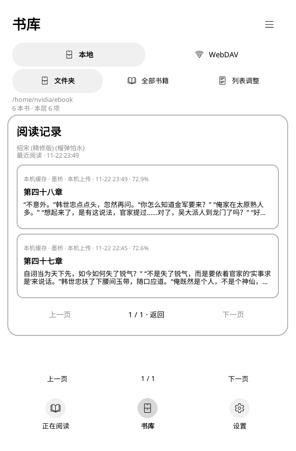
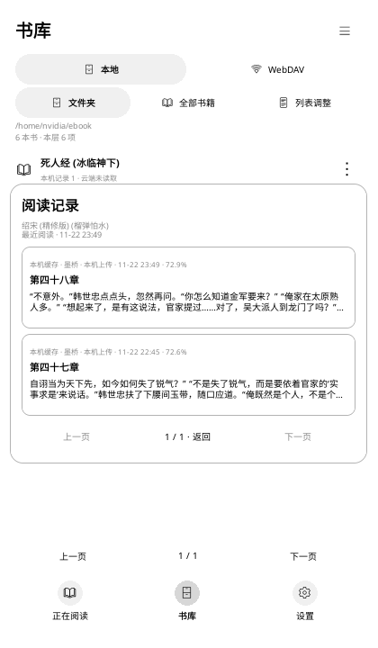
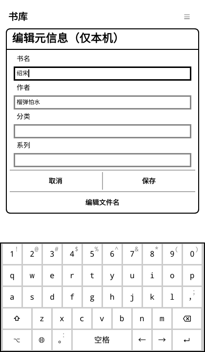
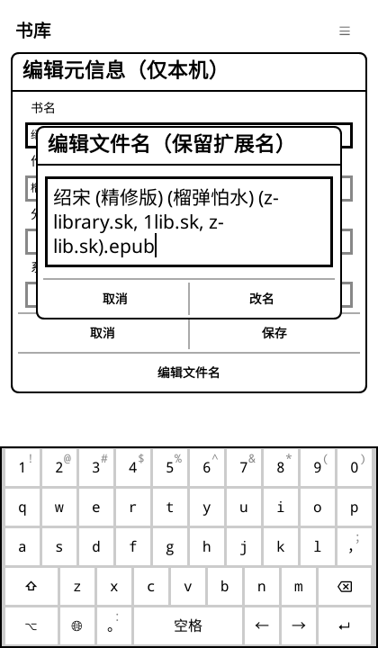

# 墨桥 0.3.30-alpha 图文指南

这一版把插件整理为两个入口：**墨负责书籍调校，桥负责跨设备同步**。同时更新首页、书库和阅读记录界面，把文件名编辑收进元信息编辑器。

本文配图使用此前在 KOReader 开发窗口保存的实际截图，包含 605×921 常规窗口和 420×720 窄窗口。书名、章节与正文为当时的演示内容；不同设备的字号和布局会随屏幕调整。

## 1. 先认识顶栏：桥与墨

顶栏最前两个入口不再直接显示汉字，改用统一的线性图标：

| 图标 | 模块 | 用途 |
|---|---|---|
| 双向箭头 | 桥 · 跨设备同步 | 上传、下载、查看同步状态和高级设置 |
| 调节滑杆 | 墨 · 书籍调校 | 书籍重构、章节跳转、内容搜索、快速跳转和首页 |

*图 1：桥模块展开后的顶栏。最左侧是桥，右侧紧邻的是墨；其他 KOReader 页签仍可使用。*

章节跳转、内容搜索和快速跳转使用 KOReader 原生阅读工具，需要先打开书籍。首页入口已移到 **墨 → 首页**。

首次使用同步功能，从 **桥 → 高级 → 存储选项 → 墨桥同步目录** 配置 WebDAV。使用 KOReader 云浏览器选目录时，需长按「Long-press here to choose current folder」。

## 2. 正在阅读：首页直接看章节与选段

正在阅读页只展示最近打开的一本书。页面包含时钟、公历与离线农历，当前书名和最近一条记录，以及两条较早的记录。每条记录尽可能展示真实章节和正文选段。

*图 2：正在阅读页。点击「继续阅读」恢复本机位置；点击记录正文则进入原书核对和跳转确认。*

首页和书库共用底部导航高度与基线，普通操作按钮也统一了尺寸。圆形图标留出独立间距，按钮点击不再出现原来的黑色反色背景。

「刷新记录」只读补入当前页面的同步记录。章节或正文不足时会如实留空；旧记录不会被补成虚构的阅读历史。

## 3. 书库：本地与 WebDAV 分开选择

书库默认读取本地目录，顶部可切换 WebDAV 来源。两种来源各自保存目录，书目目录与阅读进度同步目录也相互独立。

*图 3：点击书籍行直接阅读，点击右侧「⋮」打开这本书的操作菜单。*

**文件夹**按真实层级浏览；**全部书籍**跨子目录列出书目；**列表调整**可选择紧凑、标准或宽松行高，以及名称或最近修改排序。本地浏览不后台联网，云端记录需在书籍详情中手动读取。

## 4. 书籍详情：一个入口管理阅读记录

原来的「阅读历史」和「管理同步记录」已合并为 **阅读记录**，不必在两个入口之间切换。书籍详情还提供打开书籍、文件存留、删除文件、EPUB 元数据及手动读取云端记录。

*图 4：EPUB 的文件名编辑已移入「EPUB 元数据」，详情菜单不再重复放置改名入口。*

从 **书库 → ⋮ → 阅读记录** 进入后，上方显示最近本机阅读时间，下方按记录时间排列本机缓存与已读取的云端记录。每张卡片直接显示：

- 来源和存储范围：本机缓存或云端记录。
- 记录时间，以及记录中可用的阅读百分比。
- 章节名称；缺失时明确标注「章节未记录」。
- 两行正文摘要；点开可查看完整摘录和同步锚点。

*图 5：记录列表不再只显示一个时间标签。打开时会先关闭书籍菜单，避免记录页被遮挡。*

点击卡片可选择 **前往此处、删除此条、返回记录**。前往旧位置仍需核对原书版本及正文锚点；删除必须再次确认。本机缓存与云端记录分别处理，取消或核验失败时保留条目，不会连带清理其他记录。

*图 6：窄窗口保留章节和摘要，记录较多时使用显式分页。*

最近阅读时间来自 KOReader 本机历史，它本身不包含每次阅读的章节和正文快照。卡片中的章节、摘要来自墨桥实际保存或读取到的记录；「读取云端」也不会自动采用云端位置。

## 5. EPUB 元信息与文件名集中编辑

从 **书库 → ⋮ → EPUB 元数据** 打开同屏表单，可编辑 **书名、作者、分类、系列**。分类对应 KOReader 的关键词，系列对应丛书。点击保存一次提交四项内容，取消不保存元信息。

*图 7：元信息表单及内部的「编辑文件名」入口。*

元信息保存在 **KOReader 本机阅读数据** 中，不写回 EPUB 正文，也不会自动同步到其他设备。首页和书库的显示名称仍按当前文件名清理后显示，因此「书名」字段与「文件名」是两个独立值。

点击表单下方 **编辑文件名** 可修改实际文件名，必须保留原扩展名。改名拒绝覆盖同名文件或已有阅读数据，并通过 KOReader 迁移相关阅读数据、历史、收藏及墨桥缓存。当前打开的书籍须先关闭。

*图 8：此前保存的文件名输入框截图；最终版本另外补充了「改名立即生效」的文字提示。*

**文件名改动确认后立即生效；元信息仍需另点保存。** 改名成功后会按新路径重新打开元信息表单，并保留尚未保存的四项输入。非 EPUB 文件继续提供独立的文件名编辑入口。

「文件存留」可标记保留，阻止误删；「删除文件」可选择保留阅读数据或一并删除，每种方式都需要最终确认。删除本地书籍不会因此删除云端书籍文件。

## 6. 本次还包括哪些更新

相对上次公开发布的 `0.3.19-alpha`，本版还包含：

- **书籍重构**：从「墨 → 书籍重构」进入，可重新识别章节或按原正文文件分章，另存纯文字 EPUB 副本，提供实际进度与取消操作；不覆盖原书。
- **插件内更新**：从「桥 → 高级 → 关于插件 → 版本号」检查更新，确认后下载，校验包和版本，替换失败恢复旧插件，成功后提示重启。
- 修复检查更新时误报连接失败，以及书库读取同步记录时下载暂存接口丢失的问题。
- 完善章节与选段的只读补全、菜单分页、弹窗层级和窄屏布局。

重构适合纯文字小说，会移除图片和原样式。生成的副本按新书处理，旧书的位置和批注不会自动迁入；跨设备使用时请分发同一份副本。

## 安装与升级

1. 从 [最新版发布页](https://github.com/9990ex/inkbridge.koplugin/releases/latest) 下载 `inkbridge.moon.koplugin-v0.3.30-alpha.zip`。
2. 退出 KOReader，将压缩包中的整个 `inkbridge.koplugin/` 目录放入或覆盖到 `plugins/` 下，保持目录名不变。
3. 完整重启 KOReader。通过双向箭头进入桥，通过调节滑杆进入墨。
4. 如需默认进入首页，在首页「设置」中启用「启动／关书后进入首页」。

Android 通常使用 `/sdcard/koreader/plugins/`；Kindle 为 `koreader/plugins/`；Kobo 为 `.adds/koreader/plugins/`。具体安装位置以当前 KOReader 安装目录为准。

## 验证范围

本版通过 **18 组、1930 条 LuaJIT 回归**，并在本机 KOReader 开发窗口检查常规与窄屏界面。临时 EPUB 的真实 DocSettings 保存、磁盘回读和原文件内容不变检查通过；这些检查不代表所有设备型号均已覆盖。

分页模式按页定位，跨设备排版不同仍可能让记录中的首行落在目标页中间。完整同步原理、静读天下设置与限制见 [插件使用说明](../inkbridge.koplugin/README.md)。
