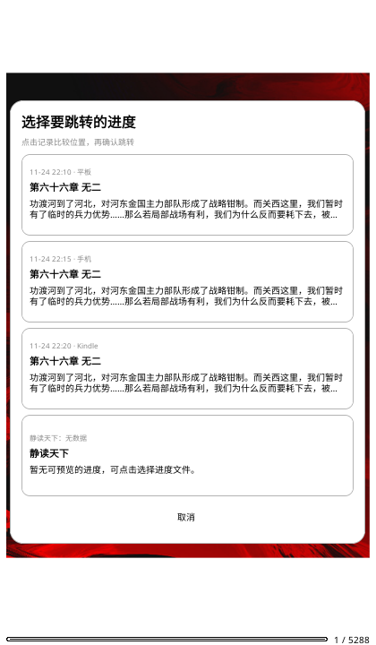
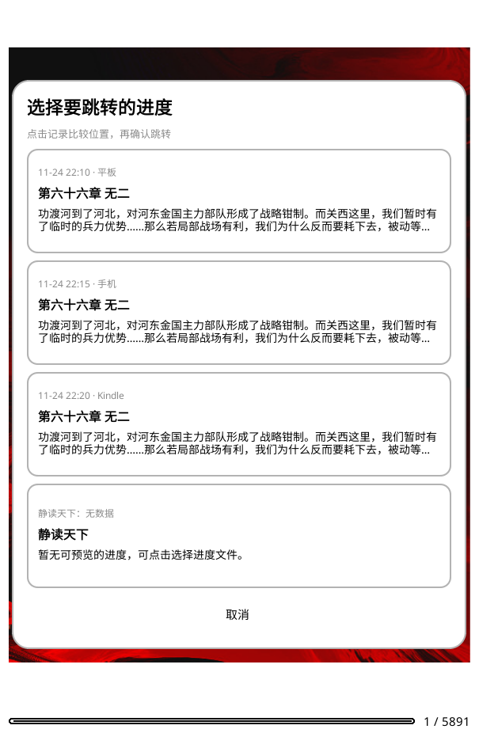

# 进度选择文字卡片验证（2026-11-24）

用户 Kindle 照片显示「选择要跳转的进度」使用三列齿轮图标，按钮只显示被截断的云端文件名，无法直接判断章节和正文。原因是此选择器仍委托通用 Material 图标菜单，而且尚未读取记录正文。

改为无图标纵向卡片，先显示列表，再逐条只读读取最近三份记录。核对完整书籍 ID 后使用原位置规划读取本机真实章节，核验正文锚点后从原文延展最多 100 字，在卡片中显示两行；未能延展时展示原记录短锚点。选择卡片仍按原流程重新下载，再显示位置比较与确认。翻页和刷新保持同一列表对象，关闭或切书后丢弃迟到响应。

## 回归

WSL Ubuntu 下执行 `sh tests/run_all.sh`，18 组、1993 条断言通过。新增 17 条覆盖无图标列表、章节与原文延展、UTF-8 和全角空格、时间与设备、书籍身份拒绝、单条失败、关闭和切书后迟到响应、选择动作委托、分页不取消预览及取消通知。`git diff --check` 通过。

## 真实 KOReader

使用 KOReader v2026.07.1、LuaJIT 与本机 WebDAV，分别运行 605×921 和 420×720 两个隔离会话。隔离目录为 `/home/nvidia/ib-history-list-lab-20261124`；测试脚本位于 Windows 临时目录 `ib-history-runtime.py`。

测试书使用前次隔离实验的真实 EPUB，云端三条测试记录复制同一份已验证锚点，仅分别设置设备和时间；用于验证展示，不代表三个不同的真实阅读位置。Moon+ 无数据项作为第四条显示。真实读取出的章节为「第六十六章 无二」，选段从「功渡河到了河北……」开始延展，未显示原文件名或装饰图标。

两种尺寸下均显示完整四条，卡片宽度分别为 532 和 369 像素，整个弹窗高度分别为 719 和 495 像素，小于屏幕高度。取消后本机 xpointer 不变；点击首条后出现「同步前位置对比」，确认之前 xpointer 仍不变。没有 PUT 或 DELETE，实验前后云端三个文件的 SHA-256 全部相同。两个进程均正常退出，临时服务已停止。

此轮实机界面验证覆盖墨桥三条记录与 Moon+ 无数据项；有数据的 Moon+ 预览复用既有字符坐标和唯一正文核验，本轮未在 Kindle 上验证。

